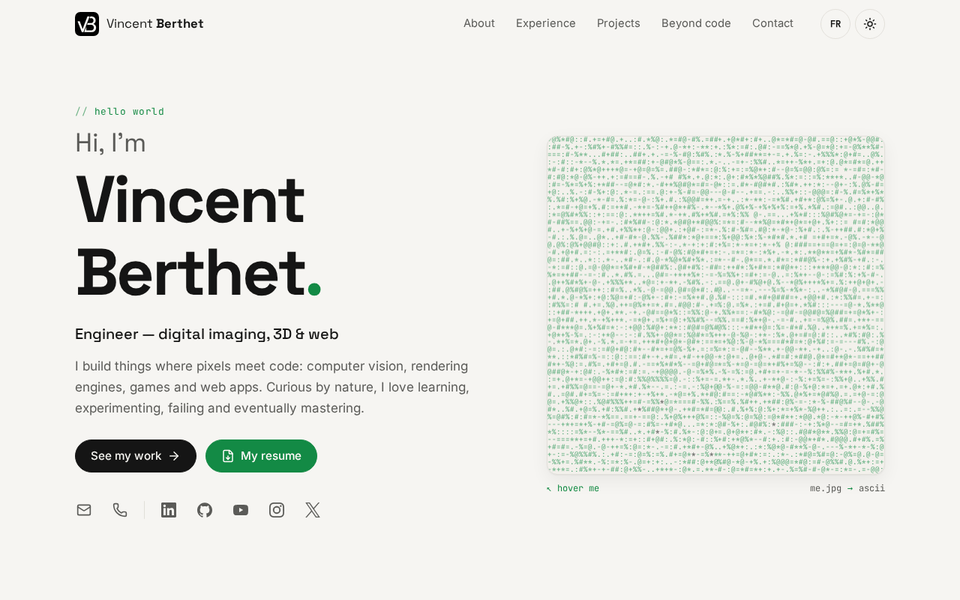

# Me

[](https://opensource.org/licenses/MIT)

My portfolio: profile, experience, projects and resume, in English and French.

**https://vincentbrth.github.io/me/** · resume ([FR](https://vincentbrth.github.io/me/cv/), [EN](https://vincentbrth.github.io/me/cv/en/)) · [email signature](https://vincentbrth.github.io/me/card/)



## Features

- **Bilingual** (English at `/me/`, French at `/me/fr/`). French browsers are redirected to the French version on their
  first visit; the language switch is then remembered.
- **ASCII portrait** drawn live from the photo, with a lens that reveals the photo on hover (or tap).
- **Projects** in chronological order, with domain filters, a "Selection" filter and badges
  (Selection, Open source, Work in progress). Archived projects are listed below the grid.
- **Project pages** with video, WebGL game, links, downloads and screenshots.
- **Resume** written in HTML, in French (`cv.html`, served at `/me/cv/`) and English (`cv.en.html`, served at `/me/cv/en/`), exported to PDF at every build.
- **Email signature** at `/me/card/` (FR) and `/me/card/en/` (EN): copy it (rich or HTML), download it as PDF or add it to contacts (.vcf).
- Light and dark themes, mobile menu, smooth page transitions (in browsers that support them).
- **Console easter egg** (`src/components/ConsoleEgg.astro`): open the browser console and type `vincent.help()`.
- **Privacy**: no cookies, no trackers, fonts self-hosted, YouTube only loaded when a video is played.
  Optional cookie-free statistics with GoatCounter.

Built with [Astro](https://astro.build): static HTML, very little JavaScript, hosted on GitHub Pages.

## Develop

Requires the Node.js version in `.nvmrc` (`nvm use`).

```sh
npm install
npx playwright install --with-deps chromium   # once: needed for the PDF, sharing images, tests and demo

npm run dev       # development server: http://localhost:4321/me/
npm run build     # type-check, production build in dist/, then resume PDF and sharing images
npm run preview   # serves dist/
npm test          # smoke test of dist/ (run npm run build first)
npm run demo      # records docs/demo.gif from dist/
```

`docker compose up` also serves `dist/` with nginx, on http://localhost:8080/me/.

If the development server shows stale content after a change in `src/content.config.ts`, stop it,
delete the `.astro/` folder and start it again.

## Edit the content

| What                                                        | Where                         |
| ----------------------------------------------------------- | ----------------------------- |
| Name, email, phone, socials, "open to work" badge, statistics | `src/data/site.ts`          |
| Experience timeline                                         | `src/data/experience.ts`      |
| Toolbox (skills)                                            | `src/data/skills.ts`          |
| "What drives me" section                                    | `src/data/beyond.ts`          |
| Interface texts, hero, about (EN / FR)                      | `src/i18n/ui.ts`              |
| Projects                                                    | `src/content/projects/*.yaml` |
| Project images                                              | `src/assets/projects/`        |
| Resume (FR / EN)                                            | `cv.html` / `cv.en.html`      |

### Projects

Each project is one YAML file with both languages side by side. The schema is in `src/content.config.ts`;
the build fails with a clear message if a field is missing or invalid.

```yaml
order: 3 # chronological position: 1 is the most recent
featured: true # "Selection" badge and filter
archived: true # moved to the Archives list (still counted and filtered, page kept)
wip: true # "Work in progress" badge
title: { en: …, fr: … }
summary: { en: …, fr: … } # card text (inline Markdown)
description: { en: …, fr: … } # project page text (Markdown)
cover: ../../assets/projects/name.webp
categories: [vision, 3d, games, web, pro, initiatives]
stack: [C++, OpenCV]
year: '2020'
links:
  source: https://github.com/… # adds the "Open source" badge when it is one of my repositories
  website: https://… # official website of a product
  demo: https://…
  download: { url: https://…, name: file.pdf, lang: fr }
video: YouTube id # shown on click only
webgl: https://… # "Play in the browser" button
gallery: [{ src: ../../assets/projects/screenshot.webp, alt: { en: …, fr: … } }]
```

Images are resized and converted to WebP at build time: drop the originals in `src/assets/projects/`.

## Resume and sharing images

`npm run build` ends with `scripts/postbuild.mjs`, which opens the built site in headless Chromium to:

- export `cv.html` to `dist/cv/CV_BERTHET_Vincent.pdf` (downloadable from `/me/cv/`) and `cv.en.html` to
  `dist/cv/CV_BERTHET_Vincent_EN.pdf` (from `/me/cv/en/`). Emojis are replaced by
  [Twemoji](https://github.com/jdecked/twemoji) drawings (CC-BY 4.0), so they print without an emoji font;
- export the email signature card to `dist/card/Carte_BERTHET_Vincent.pdf` and `dist/card/Card_BERTHET_Vincent_EN.pdf`;
- take the social sharing images (`dist/og/en.png`, `dist/og/fr.png`) from `src/pages/og/[lang].astro`.

Without Chromium, this step is skipped with a warning (locally only: it is required in CI).

## Statistics

Optional and privacy-friendly: [GoatCounter](https://www.goatcounter.com) sets no cookie and collects no
personal data, so no consent banner is needed. Create a free account and put its code in `goatcounter`
in `src/data/site.ts`.

## Deploy

- Every pull request is built and tested (`.github/workflows/ci.yml`).
- Every push to `master` is built, tested, then deployed to GitHub Pages (`.github/workflows/deploy.yml`).
  In the repository settings, **Pages → Build and deployment → Source** must be set to **GitHub Actions**.

The smoke test (`scripts/smoke.mjs`) opens every page in English and French and checks: no JavaScript
error or broken internal resource, filters, resume and its PDF, email signature, sharing images,
language redirect and legacy links.

## Project structure

```
cv.html, cv.en.html     resume in French and English (HTML, A4)
public/                 files served as is: icons, email signature images
scripts/                postbuild (PDF, sharing images), smoke test, demo recording
src/
  assets/               photo, logo, project images
  components/           home page, project page, cards, ASCII portrait, icons
  content/projects/     one YAML file per project
  data/                 site settings, experience, skills, "what drives me", legacy links
  i18n/ui.ts            interface texts in English and French
  layouts/Layout.astro  page shell: header, menu, footer, theme, language
  pages/                routes: home (en, fr), projects, cv, card, 404, sharing images
  styles/global.css     design tokens and shared styles
```

## Previous versions

- [Portfolio v1](https://vincentbrth.github.io/me_v1/) ([source](https://github.com/vincentBrth/me_v1))
- [Portfolio v2](https://vincentbrth.github.io/me_v2/) ([source](https://github.com/vincentBrth/me_v2)), before this redesign

Links of the previous version (`get.html?id=…`, `card.html`) are redirected by the 404 page
(`src/pages/404.astro`, mapping in `src/data/legacy.ts`).
